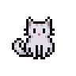

# CatNur

Masaüstünde gezen, pencerelerin üstüne zıplayan, uyuyan, müziğe dans eden bir masaüstü kedisi (Windows, WPF / .NET 8).

## Çalıştırma

Gereksinim: Windows 10/11 ve [.NET 8 SDK](https://dotnet.microsoft.com/download/dotnet/8.0).

`Derle.bat` dosyasına çift tıkla. Proje derlenir, `CatNur\` klasörüne yayınlanır ve kedi başlar.

Kapatmak için tepsideki (gizli simgeler) kedi ikonuna sağ tıkla → **Çıkış**.

## Tepsi menüsü

- **Kediyi Merkeze Al / Kurtar**: kediyi birincil monitörün üstüne getirir.
- **Monitörler Arası Geçiş Yap**: kediyi sıradaki monitöre gönderir.
- **Çıkış**

## Kullanım

- Tek tık: miyavlar. Çift tık: tıslar.
- Tutup sürükleyerek fırlatabilirsin (monitörler arası sürükleme dahil).
- Kedi bulunduğu monitörde kalır; zıplama, uyuma ve gezinme o monitörle sınırlıdır.

Windows'un kendi panelleri (Hızlı Ayarlar, Başlat vb.) kedinin üstünde çizilir, bu bir işletim sistemi kısıtıdır.
